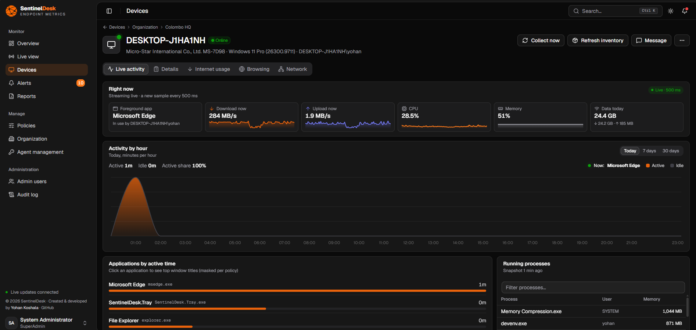
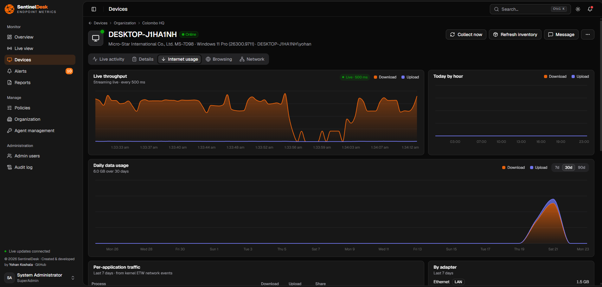

<p align="center"><picture><source media="(prefers-color-scheme: dark)" srcset="doc/logo/SentinelDesk-logo-dark.png"></picture></p>

# SentinelDesk — Endpoint Monitoring & Management

Implementation of [doc/Endpoint-Monitoring-System-Blueprint.md](doc/Endpoint-Monitoring-System-Blueprint.md):
a protected Windows tray agent on every company PC/laptop plus a central, real-time web console.

## Screenshots

**Live activity:** what a device is doing right now (foreground app, live download/upload, CPU, memory, data today),
streamed every 500 ms while you watch, plus active/idle time by hour, applications by active time and running processes.



**Internet usage:** live throughput, today by hour, daily data usage over 7/30/90 days, per-application traffic
(from kernel ETW network events) and usage by network adapter.



```
src/
  SentinelDesk.Shared/   contracts, AES-GCM/RSA-OAEP payload crypto, ECDSA signing, HMAC device auth, URL categories
  SentinelDesk.Agent/    Windows service (LocalSystem): collectors, encrypted offline queue, uploader, live command channel
  SentinelDesk.Guard/    watchdog service: restarts agent, binary-integrity check, verified updates with rollback
  SentinelDesk.Tray/     per-user tray app: status icon, monitoring notice, foreground-app/idle tracking (no Exit)
  SentinelDesk.Server/   ASP.NET Core: agent API, console REST API, SignalR hubs, alert engine, retention, demo fleet
web/console/             React + TypeScript + Tailwind console (built into the server's wwwroot)
deploy/agent/            install-agent.ps1 / uninstall-agent.ps1 (GPO / Intune / SCCM)
build.ps1                release build → publish/
```

## Quick start (development)

Requirements: .NET 10 SDK, Node 20+.

**One command:** `.\dev.ps1` starts the server and opens the console; `.\dev.ps1 -Agent` also runs the agent and tray
on this PC (they enroll automatically with the built-in dev token). Use an Administrator terminal for full collection.

Or manually:

```powershell
cd web/console; npm install; npm run build          # builds the console into the server's wwwroot
cd ../../src/SentinelDesk.Server
$env:ASPNETCORE_ENVIRONMENT = 'Development'          # enables the simulated island-wide demo fleet
dotnet run
```

Open **http://localhost:5080** and sign in as `admin` / `ChangeMe@2026` — you are forced to set a new password at first sign-in.
For UI work run `npm run dev` in `web/console` (http://localhost:5173, proxies to the server).

Demo mode creates ~40 simulated devices across 12 branches with 14 days of history. Remove them under
*Agent management → Trust & keys → Purge simulated devices*, and keep `Demo:Enabled=false` in production.

### Try a real agent on your PC

1. Console → *Agent management* → *New token*.
2. As administrator (needed for ETW network/DNS collection and USB control):

```powershell
cd src/SentinelDesk.Agent
dotnet run -- enroll --server https://localhost:5443 --token SD-XXXX --tofu
dotnet run                                      # runs in the console; Ctrl+C to stop
```
Run `src/SentinelDesk.Tray` too to feed application-usage time.

## Production deployment

```powershell
./build.ps1
```

**Server:** copy `publish/server` to the data-centre host. Configure `appsettings.json` (Kestrel certificate for
your public hostname, `Security:RequireMtls=true`, SMTP/webhook, retention), then register it as a service:
`sc.exe create SentinelDeskServer binPath= "C:\SentinelDesk\SentinelDesk.Server.exe" start= auto`.
Expose only 443 (agents + console) through your firewall/reverse proxy. Data and key material live in `data/`;
back that folder up, and keep it out of source control.

**Agents — one file per office (recommended):** in the console open *Agent management → Office installer*, pick the
branch, enter the server address the offices can reach and your uninstall key, and click *Download setup*. You get
`SentinelDesk-Setup-<Branch>.exe` (~37 MB, an NSIS installer built from `deploy/setup/SentinelDesk-Setup.nsi`) with the
server address, a fresh enrollment token and the uninstall-key hash built in. Staff double-click it (UAC / admin), or IT
deploys it silently: `SentinelDesk-Setup-<Branch>.exe /quiet` (or `/S`; exit code 0 = installed; log in
`C:\Windows\Temp\SentinelDesk-Install.log`). The unconfigured `publish/SentinelDesk-Setup.exe` asks for those values, or
takes `/server URL /token TOKEN /key KEY [/pin SHA256] [/tofu] [/quiet]`. Building it needs NSIS 3 (`winget install NSIS.NSIS`).

**Uninstall:** *Apps & features → SentinelDesk Agent*, or `C:\Program Files\SentinelDesk\Uninstall.exe`. It asks for the
Uninstall Key or a per-device one-time code. Silent: `Uninstall.exe /S /key=<key>` (exit code 0 = removed).

**Agents — scripted:** push `publish/agent` and run elevated:

```powershell
powershell -ExecutionPolicy Bypass -File install-agent.ps1 -ServerUrl https://monitor.company.lk `
  -EnrollToken SD-XXXX -UninstallKey "<organisation uninstall key>"
```

**Upgrades:** upload `publish/SentinelDesk-Agent-<ver>.zip` under *Agent management → Releases*, then roll out
10 % → 50 % → 100 %. Devices are bucketed deterministically, so raising the percentage only adds devices.

## How the blueprint requirements are met

| Requirement | Implementation |
|---|---|
| Tray agent on every PC | `SentinelDesk.Agent` service + `SentinelDesk.Tray` (green/amber/red shield; menu: Status, Monitoring notice, Contact support, About — no Exit). The agent relaunches a killed tray in every session and raises `tamper.trayKilled`. |
| Install/uninstall need admin credentials | Elevated install. Service DACLs: only SYSTEM can stop, change or delete. Uninstall needs admin rights **and** the Uninstall Key (PBKDF2-hashed) or a per-device one-time code from the console. The key is checked only by a SYSTEM task; after 5 wrong keys uninstalling is locked for 30 minutes (`tamper.uninstallAttempt`, `tamper.uninstallLockout`). Guard and Agent restart each other. Stops, kills, binary changes, clock changes and forged commands raise alerts. |
| Protection against local administrators | The data folder (device secret, queue key, uninstall-key hash) is readable by SYSTEM only. Agent and Guard lock the services' registry keys to SYSTEM, register both services for Safe Mode, and repair and report any change to start type, program path, service account, deletion or tray auto-start (`tamper.serviceConfig`). A device that goes silent for more than 24 h raises a critical *possible removal* alert. |
| Advanced encryption | TLS 1.2/1.3 with per-device ECDSA P-256 client certificates issued by the server's internal CA (TPM-backed key when available, bound to the device record). Every batch is AES-256-GCM with a fresh key wrapped by RSA-3072-OAEP. Offline queue: AES-256-GCM with a DPAPI-sealed key. Policies, commands and update packages are ECDSA-signed. Per-request HMAC device tokens with replay protection. Server keys are DPAPI-protected. |
| Central configuration | Policies (collectors, intervals, title masking, excluded apps/domains, working hours, USB block, offline buffer, tray notice) assigned to org units or devices with inheritance, pushed instantly over SignalR. |
| Deep per-device view | Summary (live gauges and throughput), hardware, software with change history, applications (active/idle by hour, window titles, running processes), bandwidth (live, hourly, daily, per adapter, per application), websites (domains and categories), sessions, USB, security posture, unified timeline, remote commands. |
| Island-wide | Outbound-only HTTPS from agents. Offline buffering (size/age capped). Exponential backoff with jitter. Branch map, org hierarchy (organization → region → branch → department), branch-scoped admins. |
| Console | Overview dashboard, Live view, Devices, Alerts and rules (email/webhook), Reports with CSV export, Policies, Organization, Agent management, Admin users (RBAC + TOTP MFA), Audit log, Ctrl+K search, light/dark themes (including themed drop-down menus and in-app dialogs). |
| Device location | Optional, per policy (*Collectors → Device location*, off by default). The tray reads Windows Location (Wi-Fi / GPS / IP based) in the signed-in user's session every few minutes. Devices appear as dots on the Overview map, and the device page has a *Location* tab with the accuracy radius and a 24 h / 7 day / 30 day trail. History is kept 30 days (`Retention:LocationDays`). Not visible to HR viewers; every trail view is audited. |
| Blocking applications and websites | *Policies* has three kinds of block policy: **Block websites**, **Block applications** and **Block USB drives**, each applied to all computers, a branch/department or single devices. They stack: a device gets the Default monitoring settings plus every block policy on it, its department, branch, region or the organization, merged into one signed policy (blocking that older versions kept inside monitoring policies is moved into block policies on start-up). Rules: program names (`steam.exe`, wildcards such as `*torrent*.exe`), websites (`tiktok.com` blocks the site and its subdomains, `youtube.com/shorts` blocks one section) and built-in categories (Social, Gaming, Streaming, …). Applications: an Image File Execution Options redirect stops Windows from starting the program and shows a "blocked by your organisation" notice, and a process watcher (kernel ETW + 3 s sweep) closes running copies and wildcard matches. Websites: the Chrome, Edge, Brave and Firefox enterprise URL block lists (the browser's own blocked page, path rules supported) plus a managed hosts-file section for every other app. Re-applied every minute; local changes are reverted and raise `tamper.blockList`. Attempts are logged as `block.app` / `block.web` (alert rule *Blocked application or website*). Windows, sign-in and SentinelDesk programs and domains cannot be blocked. Uninstall removes every block. |
| Enrollment tokens | Each token lists the devices it enrolled, with live online status. Active tokens can be copied again at any time (stored encrypted; every copy is audited). Older tokens kept only as a hash can be given a new value in place, without affecting enrolled devices. |

### Deliberate differences from the blueprint (MVP scope)

- **Database:** EF Core on SQLite, so the system runs with zero infrastructure. Time-series tables plus a daily rollup
  (the continuous-aggregate equivalent) are indexed for this. For thousands of devices, switch to
  `Npgsql.EntityFrameworkCore.PostgreSQL` + TimescaleDB hypertables (the schema maps one-to-one).
- **Transport:** HTTPS/JSON and SignalR instead of gRPC. The security properties are the same (mTLS plus encrypted, signed payloads).
- **Message bus / Redis:** in-process (`PresenceStore`, background services). Add these when scaling the server out horizontally.
- **Installer:** PowerShell scripts instead of a WiX MSI. The steps map directly to MSI custom actions; code-sign the binaries for production.
- **Uninstall-key hash:** PBKDF2-SHA256 (310k iterations) rather than Argon2id, which is not in the .NET base library.
- **Not yet built:** browser extension for full URLs, PDF reports, scheduled report e-mails, macOS/Linux agents.

## Privacy (PDPA No. 9 of 2022)

Visible tray icon and monitoring notice. No keystrokes, screenshots or content. Domain-level web logging by default.
Window titles are masked by default and can be switched off. Excluded apps and domains. A working-hours gate.
Device location is off unless a policy enables it; users are then told once by the tray and in the monitoring notice.
HR viewers cannot see websites, titles or live activity. Every view and export is audited. Raw telemetry is kept 90 days
and aggregates 2 years (configurable). Install only on company-owned devices, and have HR/legal approve the policy before rollout.

## License & author

**Proprietary software. © 2026 Yohan Koshala. All rights reserved.**

SentinelDesk was created and developed by **Yohan Koshala**
([github.com/tenzaicbt](https://github.com/tenzaicbt) · [www.lordefx.com](https://www.lordefx.com)).
No part of it may be copied, modified, distributed or resold without his written permission.
See [LICENSE](LICENSE) for the full terms. Bundled open-source components remain under their own licenses.
